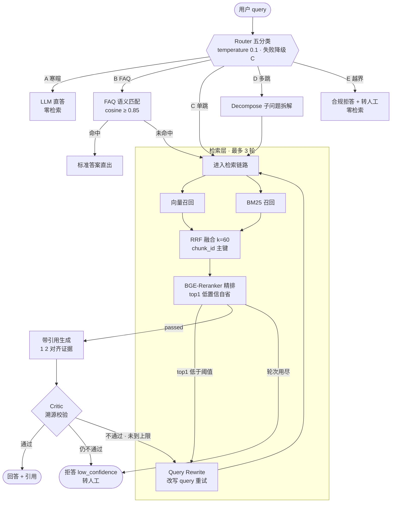
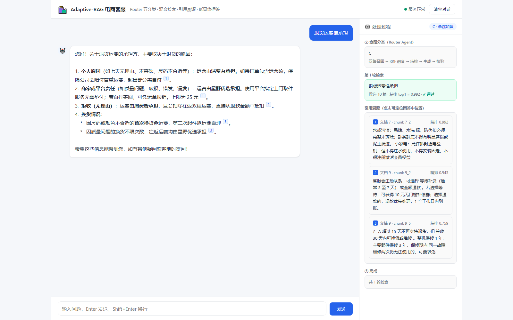

# Adaptive-RAG 电商客服系统

> **一句话定位**：不是「切分 → 向量化 → 检索 → 生成」的固定流水线，而是**先判断问题是什么，再决定用不用检索、检索几次、要不要拒答**的电商客服问答系统。
>
> **已量化**（280 条分层评测，同评测集、同 prompt 版本）：路由准确率 **71.1% → 87.1%**，FAQ 命中率 **0% → 88%**，误拒率 **2.8% → 2.0%**，P50 时延 **4.1s → 3.6s**（平均 3.7s → 3.2s）。原始记录见 [`eval/results/`](eval/results/)。

> **在线演示**：[点击打开 Demo](https://adaptive-rag-demo.app.workbuddy.host/?sharecode=VXCR5K742D)（静态样例回放版，展示真实评测与 FAQ 种子数据中的路由、检索、精排、溯源与拒答流程；实时 SSE 版需按下方步骤本地启动服务）。

---

## ✨ 项目亮点

| 能力 | 说明 |
|------|------|
| 🧭 **Router 五分类分治** | A 寒暄 / B FAQ / C 单跳 / D 多跳 / E 越界，每类有独立处理路径与成本策略——这是 Adaptive 与固定 pipeline 的分水岭 |
| 🔀 **混合检索** | BM25 关键词 + DashScope 向量双路召回，RRF 排名融合（k=60），BGE-Reranker 精排——两路缺陷互补，非简单堆料 |
| ✍️ **Query Rewrite 多轮重试** | 多轮对话指代消解；精排低置信时自动改写 query 重试（原始 + 最多 2 次改写） |
| 🛡️ **双拒答防线** | 检索层低置信自省（rerank top1 < 0.3）+ 生成层 Critic 溯源校验，不编造、转人工 |
| 📎 **带引用生成** | 每个事实陈述标注 `[1][2]`，可点击溯源到具体 chunk 与文档 |
| 📡 **SSE 流式 + 过程可视化** | 打字机回答；右侧面板实时展示分类、每轮检索分数、引用溯源——重试过程对用户可见 |
| 🔧 **可调试、可评测** | `/debug/retrieve` 暴露全链路中间结果；编排与评测共用同一入口，评测和线上永不脱节 |

---

## 🏗️ 系统架构



**多智能体的本质**：不是多个 LLM 互相聊天，而是**职责单一、可独立评测、可替换、通过结构化 JSON 通信**的协作单元（Router / Rewrite / Decompose / FAQ / 生成 / Critic）。

---

## 📊 优化前后：同样 280 条，只改了路由与 FAQ

| 指标 | 优化前 | 优化后 | 变化 |
|---|---|---|---|
| 路由准确率 | 71.1% | **87.1%** | +16.0pp |
| FAQ 命中率 | 0% | **88%** | +88pp |
| 误拒率 | 2.8% | **2.0%** | -0.8pp |
| P50 时延 | 4.1s | **3.6s** | -0.5s |
| 平均时延 | 3.7s | **3.2s** | -0.5s |
| 答案关键词命中 | 62.3% | 67.7% | +5.4pp |
| 证据命中 | 80.0% | 85.5% | +5.5pp |
| Critic 通过率 | 96.7% | 97.0% | +0.3pp |
| 平均检索轮数 | 0.76 | 0.60 | -0.16 |

- 两轮都是**关闭精排的消融口径**（280 条，A–E 分层），保证可比；原始记录：[优化前](eval/results/adaptive_norerank_280.jsonl.summary.json) / [优化后](eval/results/adaptive_280_faq.jsonl.summary.json)。
- 时延口径：两轮同口径，P50 4.10s → 3.64s、平均 3.70s → 3.16s；下表 ALL 行 P50 3.6s 为四舍五入。
- 这一轮只做了两件事：① Router 寒暄规则**右锚定**，修掉「大家电…」被前缀匹配成「大家好」的误判（B 类路由 0% → 88%）；② 灌入 **62 条 FAQ 种子**，让 B 类从「全部降级 C」变成直出（FAQ 命中 0% → 88%，B 类答案命中 62% → 96%）。
- 时延下降主要来自 FAQ 直出与轮数减少，而非模型变快。

---

## 🖼️ 运行截图

<p align="center">
  
</p>

<p align="center"><sub>C 类单跳：右侧过程面板实时显示 Router 分类、检索轮次、精排分数（top1 0.992）与引用溯源；含精排时单条约 25–35s（CPU），关闭精排约 4s。</sub></p>

本地复现：`python main.py` → 打开 <http://127.0.0.1:8000/> → 点示例问题「退货运费谁承担」。

---

## ⚠️ 已知短板：D 类多跳

| D 类（50 条） | 结果 |
|---|---|
| 路由准确率 | 56% |
| 证据命中 | 66% |
| 双事实答案命中 | **26%** |
| 误拒率 | 6% |
| P50 时延 | 5.3s |

两处断点：

1. **路由**：近一半 D 类被当成 C 类，只检索一次，天然漏掉另一个子问题——这是当前最大的单点损失。
2. **生成**：证据命中 66% 但双事实答案命中仅 26%，差 40 个百分点，说明「检索到了却没讲全」，瓶颈在子问题证据合并后的逐条覆盖，不在召回。

下一步优先级：先修 D/C 边界（分类提示词 + 少数样例），再做「按子问题逐条作答」的生成约束与引用对齐，最后用语义切分提升证据聚焦度。其余工程限制见文末「已知限制」。

---

## 🧭 Router 五分类

| 类别 | 典型 query | 处理路径 | 设计理由 |
|------|-----------|---------|---------|
| A 寒暄/常识 | "在吗" | LLM 直接答，**不检索** | 检索是时延和成本的浪费 |
| B FAQ 精确命中 | "支持七天无理由吗" | FAQ 库语义匹配直出 | <0.5s，用户体验最好 |
| C 单跳知识 | "退货运费谁承担" | 完整检索链路 | 一次检索可答 |
| D 复合/多跳 | "订单还没到，退货的话运费谁出" | 拆解子问题 → 分头检索 → 合并证据 → 原始 query 统一精排 | 单次检索必然答不全 |
| E 越界/敏感 | "帮我把订单价格改成1元" | 边界拒答 + 转人工 | 电商场景特有的合规兜底（论文里没有，业务里必须有） |

---

## 🔧 技术选型与理由

> RAG 不是堆砌最新技术，而是按需求做合理选型。每一项都说明"为什么是它"和"什么时候该换"。

| 组件 | 选型 | 理由 | 规模上限后的替代 |
|------|------|------|----------------|
| LLM / Embedding | DashScope `qwen3.5-flash` / `text-embedding-v2` | 国内可直连、免部署、flash 定位低成本（Router/生成/Critic 全链路覆盖） | 换 GPT/Claude 或私有化 vLLM |
| 向量库 | ChromaDB（本地持久化） | 零服务依赖、单机 demo 到百万 chunk 都够用 | Milvus / Qdrant（分布式） |
| 关键词检索 | `rank_bm25` + jieba | 纯内存、即插即用；与向量缺陷互补（精确匹配专名/数字） | Elasticsearch（十万级以上，见已知限制） |
| 融合算法 | RRF（k=60） | 两路分数量纲不可比（BM25 无上界 vs cosine 0~1），**只用排名比**，无需调权重 | 学习式融合（需要大量点击数据） |
| 精排 | BGE-Reranker-v2-m3（本地） | cross-encoder 对 query-doc 对精细打分，补上 RRF 丢失的细粒度相关度 | 云端 Rerank API |
| Web 框架 | FastAPI + SSE | 原生 async + StreamingResponse，流式零额外依赖 | WebSocket（双向场景才需要） |
| ORM | Tortoise + SQLite | 异步 ORM 与 FastAPI 同生态；单机零维护 | PostgreSQL（多实例部署） |

---

## 📁 目录结构

```
adaptive_rag_ecommerce_customer/
├── main.py                  # FastAPI 入口：lifespan 重建 BM25 + 路由注册 + 首页
├── config.py                # 全局配置：API key、检索超参数、DB、重试策略
├── requirements.txt
├── index.html               # 前端演示页（单文件零依赖，接 SSE）
├── docs/images/             # README 运行截图
├── routers/                 # 接口层
│   ├── doc_router.py        #   文档上传/列表/删除（双路索引同步维护）
│   ├── agent_router.py      #   SSE 流式问答 + 同步评测接口
│   └── debug_router.py      #   召回详情可视化 + FAQ 管理 + 索引体检
├── models/                  # Tortoise ORM
│   ├── document.py          #   文档表
│   └── faq.py               #   FAQ 知识库表（B 类路由数据源）
├── services/                # 业务层
│   ├── pdf_service.py       #   PDF 解析、文本切分
│   ├── embedding_service.py #   向量化
│   ├── bm25_service.py      #   BM25 关键词检索（内存索引）
│   ├── rrf_service.py       #   RRF 融合（chunk_id 主键）
│   ├── rerank_service.py    #   BGE 精排 + 低置信自省
│   ├── agent_service.py     #   多智能体编排核心（Router/Rewrite/Decompose/生成/Critic）
│   └── prompt_templates.py  #   提示词资产层（版本化管理，改模板=升版本+重跑基线）
├── common/                  # 统一日志、返回体
├── data/                    # 上传 PDF 本地存储
│   └── seed_docs/           #   内置演示知识库（3 份 PDF，_src/ 下为可编辑的 HTML 源）
├── scripts/
│   └── seed_knowledge.py    #   离线批量导入种子 PDF（DB + Chroma + BM25 一次写齐）
├── chroma_db/               # Chroma 向量库持久化目录
└── eval/                    # 评测：test_dataset.csv（280 条）+ retrieval_eval / adaptive_eval
```

---

## 🚀 快速开始

### 1. 环境要求

- Python 3.10+
- （可选，精排加速）CUDA 环境；无 GPU 可跑，BGE-Reranker 自动用 CPU

### 2. 安装

```bash
cd adaptive_rag_ecommerce_customer
python -m venv .venv
.venv\Scripts\activate          # Windows
# source .venv/bin/activate     # macOS/Linux
pip install -r requirements.txt
```

### 3. 下载精排模型（首次必做）

精排模型 `BAAI/bge-reranker-v2-m3` 约 2.2GB，**不进 git**，首次需自行下载。

```bash
# 方式 A：走 HuggingFace 镜像（可移植，推荐）
set HF_HUB_DISABLE_XET=1                    # 镜像站不支持 Xet 协议，必须禁用
huggingface-cli download BAAI/bge-reranker-v2-m3 ^
    --local-dir ./local_models/bge-reranker-v2-m3

# 方式 B：走 ModelScope（国内更稳）
modelscope download --model BAAI/bge-reranker-v2-m3 ^
    --local_dir ./local_models/bge-reranker-v2-m3
```

`config.py` 会**自动探测** `local_models/bge-reranker-v2-m3`，存在即优先使用（优先级：环境变量 `RERANK_MODEL_PATH` > 本地目录 > HF 仓库名）。

即使模型缺失服务也能启动——`rerank_service` 内置**熔断降级**：加载失败后自动回退到 RRF 顺序返回结果，不会卡住请求。但此时 `rerank top1_score` 为空、低置信自省失效，`GET /debug/status` 里 `rerank.circuit_open` 会是 `true`；下载完模型后调 `POST /debug/rerank/reset` 即可恢复，无需重启。

### 4. 配置 API Key

```bash
set DASHSCOPE_API_KEY=sk-xxx    # Windows
# export DASHSCOPE_API_KEY=sk-xxx   # macOS/Linux
```

### 5. 导入内置知识库（推荐，一条命令）

`data/seed_docs/` 已内置 3 份可直接使用的电商客服文档（虚构品牌「星野优选」）：

| 文件 | 内容 | 页数 | 覆盖考点 |
|------|------|------|----------|
| `退货与退款政策.pdf` | 七天无理由、质量问题退换、退款时效、满减扣回、价保 | 6 | C 类单跳 / D 类多跳 |
| `配送与物流服务说明.pdf` | 运费标准、时效表、大件送装、签收验货、丢件赔付 | 5 | C 类单跳 |
| `常见问题FAQ手册.pdf` | 62 条口语化问答（订单/退换/物流/商品/会员/发票/账号） | 6 | B 类 FAQ / 词汇鸿沟 |

```bash
python scripts/seed_knowledge.py          # 导入（已存在的按文件名跳过，可反复执行）
python scripts/seed_knowledge.py --reset  # 改了 PDF 内容后重新导入
python scripts/seed_knowledge.py --list   # 查看库内文档与 chunk 数
```

脚本直接调用 service 层，**不依赖服务启动、不依赖前端**，并把 DB 元数据、Chroma 向量、BM25 内存索引三处一次写齐——避免"向量库有、BM25 没有"导致 RRF 融合静默失效。

> PDF 源文件是 `data/seed_docs/_src/` 下的 HTML，改文案后用浏览器「打印为 PDF」即可重新生成，版式与字体（微软雅黑）保持一致。

### 6. 启动

```bash
python main.py
```

| 入口 | 地址 |
|------|------|
| **在线样例回放**（无需启动） | https://adaptive-rag-demo.app.workbuddy.host/?sharecode=VXCR5K742D |
| 前端演示页（本地实时） | http://127.0.0.1:8000/ |
| API 文档（Swagger） | http://127.0.0.1:8000/docs |
| 健康检查 | http://127.0.0.1:8000/health |

### 7. 使用流程

1. 打开前端页 → 提问（知识库已由 `scripts/seed_knowledge.py` 灌好，也可在调试面板继续上传 PDF）
2. 前端提问 → 右侧过程面板实时展示分类、检索轮次、精排分数、引用溯源
3. 可用 `/debug/retrieve?query=xxx` 单独查看某 query 的召回详情（不生成回答）

---

## 📡 API 接口

| 方法 | 路径 | 说明 |
|------|------|------|
| GET | `/` | 前端演示页 |
| GET | `/health` | 健康检查 |
| POST | `/doc/upload_pdf` | 上传 PDF：解析 → 切 chunk → 双路入库（Chroma + BM25 同步维护） |
| POST | `/doc/list` | 文档列表 |
| DELETE | `/doc/{doc_id}` | 删除文档（两路索引同步删除） |
| POST | `/agent/chat` | **SSE 流式问答**（前端消费） |
| POST | `/agent/chat_sync` | **同步 JSON 问答**（评测脚本消费，返回含 trace 的完整对象） |
| GET | `/debug/retrieve?query=&top_k=` | 召回详情：双路原始召回 + RRF + rerank + 分段耗时 |
| GET | `/debug/status` | 索引体检：两路数量一致性（diff_by_doc 定位漂移） |
| POST | `/debug/faq` | 新增 FAQ |
| GET | `/debug/faq/list` | FAQ 列表 |
| DELETE | `/debug/faq/{faq_id}` | 删除 FAQ |
| POST | `/debug/faq/reload` | 手动重载 FAQ 缓存 |

### SSE 事件协议（`/agent/chat`）

```
start → route → [faq | decompose] → round × N → answer_start → chunk × N → citations → done
拒答：start → route → round × N → refused → done
异常：任意位置可能出现 error
```

```bash
curl -N -X POST http://127.0.0.1:8000/agent/chat \
  -H "Content-Type: application/json" \
  -d '{"query": "退货运费谁承担", "history": []}'
```

---

## 🧠 核心设计决策（面试向）

1. **为什么用 RRF 而不是加权融合 BM25 分数和 cosine 分数？**
   两路分数量纲不可比（BM25 无上界、cosine 0~1），任何线性加权都等于把决策权让给量纲更大的一方。RRF 只用排名——排名是跨系统唯一可比的尺度，且无需调权重。

2. **为什么 RRF 用 `chunk_id` 做主键而不是 `doc_id`？**
   同一文档的不同 chunk 是独立证据，必须独立计分；用 doc_id 会互相覆盖合并，等于丢掉文档内部的相关度区分。

3. **为什么有两道拒答防线？**
   低置信自省（rerank top1 < 阈值）在**检索层**拦截"证据本身不够"；Critic 溯源校验在**生成层**拦截"证据够但答案没被支撑"。两层故障模式不同，缺一不可。双指标考核：正确拒答率 + 误拒率，只看一个会翻车。

4. **为什么 FAQ 用语义匹配而不是让 LLM 判断？**
   FAQ 是高频标准问题，语义匹配（余弦 ≥ 0.85）只需**一次 embedding 调用**（实测 150-300ms，取决于网络）即可直出，零 LLM 调用；且标准答案人工审定，质量可控。
   注意：这里的瓶颈不是余弦计算（当前 62 条 FAQ，矩阵内积可忽略），而是 embedding 的网络往返——若追求 10ms 级，需换本地 embedding 模型或加 query 向量缓存。

5. **为什么服务启动时要从 Chroma 重建 BM25？**
   BM25 是纯内存索引，重启即丢失。不重建则混合检索**静默退化**成向量单路——不报错、不 500，只是效果变差，极难排查。内存状态的持久化恢复是落地系统与 Demo 的分水岭。

6. **为什么提示词单独放 `prompt_templates.py`？**
   提示词是"配置资产"不是代码逻辑。集中管理才能锁版本、控制实验变量——跑 Baseline vs Adaptive 对比时，prompt 和代码一样是变量，锁不住版本，对比数字就不可信。

7. **为什么评测和线上共用 `agent_run()` 一个入口？**
   编排逻辑只有一份，接口层只做交付格式适配（SSE 给人 / JSON 给脚本）。评测和线上永不脱节——两套实现的系统，评测数字没有参考价值。

8. **为什么 Critic 审核器故障时选择 fail-open（放行+打标）而不是 fail-closed（拒答）？**
   误拒一篇合格回答的成本，高于漏放一篇（主防线已过、有引用可查）。降级行为必须进 trace 的 `degraded` 字段让监控可见——**任何降级都必须是显式的**。

---

## 📊 评测体系

> **先评测、后优化**——没有基线数字，一切改进都无法量化。这是本项目与"玩具 Demo"的分水岭。

**两个可运行脚本**：`eval/retrieval_eval.py`（只测检索链路，不经过生成）和
`eval/adaptive_eval.py`（走完整 `agent_run()`，产端到端指标）

```bash
python eval/retrieval_eval.py               # 内置 12 条冒烟用例，含 rerank
python eval/retrieval_eval.py --no-rerank   # 只测 RRF 召回，快 10 倍，适合调参
python eval/retrieval_eval.py --csv eval/test_dataset.csv --top-k 5
```

输出 Recall@k / Precision@1 / MRR / 平均耗时。**Recall 低是召回瓶颈，Precision@1 低是排序瓶颈**——两者指向完全不同的优化动作。
脚本会自己从 Chroma 重建 BM25（独立进程拿不到服务的 lifespan 内存索引），所以数字可信。

- **评测集**：`eval/test_dataset.csv`，**280 条**，分层覆盖 A-E：A 寒暄 30 / B FAQ 50 / C 单跳 120 / D 多跳 50 / E 越界 30
  列格式：`id,question,category,expected_keywords,expected_doc,expected_route,expected_refusal,min_hits`，
  关键词用 `|` 分隔（命中任一即算命中），D 类 `min_hits=2` 要求两个事实同时命中。
  全部标签已通过知识库自检——每个关键词都能在 Chroma 对应文档的 chunk 中原样找到，排除"标签写错导致假阴性"。
- **检索指标**：Recall@k / Precision@1 / MRR（见上）
- **端到端指标**：路由准确率 / 拒答准确率 / 误拒率 / 漏拒率 / 答案关键词命中 / 证据命中 /
  FAQ 命中 / Critic 通过率 / 平均检索轮数 / P50、P90 时延（trace 字段直接统计）
- **对比实验**：Baseline（固定 pipeline：无 Router / 无 Rewrite / 无拒答）vs Adaptive（本系统），
  同一评测集、同一 prompt 版本号——Adaptive 侧基线已产出，Baseline 侧待跑

```bash
python eval/retrieval_eval.py --csv eval/test_dataset.csv --categories C,D --no-rerank
python eval/adaptive_eval.py --csv eval/test_dataset.csv --no-rerank \
    --out eval/results/adaptive_norerank_280.jsonl
python eval/adaptive_eval.py --csv eval/test_dataset.csv --per-category 8   # 含精排分层抽样
```

### 检索基线（C/D，170 条，chunk 级关键词命中）

| 品类 | N | Recall@3 | Precision@1 | MRR | 平均耗时 |
|---|---|---|---|---|---|
| C | 120 | 87% | 65% | 0.746 | 0.16s |
| D | 50 | 92% | 64% | 0.767 | 0.15s |
| ALL | 170 | 88% | 65% | 0.752 | 0.15s |

### Adaptive 端到端基线（全量 280 条，关闭精排消融 · 最新一轮）

| 品类 | N | 路由 | 拒答 | 误拒 | 答案 | 证据 | FAQ | Critic | 平均轮数 | P50 | P90 |
|---|---|---|---|---|---|---|---|---|---|---|---|
| A | 30 | 100% | 100% | 0% | - | - | - | - | 0.00 | 0.0s | 2.1s |
| B | 50 | 88% | 100% | 0% | 96% | 100% | 88% | 100% | 0.12 | 1.1s | 3.8s |
| C | 120 | 94% | 98% | 2% | 73% | 88% | - | 98% | 0.96 | 4.0s | 5.3s |
| D | 50 | 56% | 94% | 6% | 26% | 66% | - | 93% | 0.92 | 5.3s | 7.7s |
| E | 30 | 97% | 97% | - | - | - | - | 100% | 0.03 | 0.9s | 1.1s |
| **ALL** | **280** | **87.1%** | **97.9%** | **2.0%** | **67.7%** | **85.5%** | **88%** | **97.0%** | **0.60** | **3.6s** | **5.7s** |

答案/证据分母 220（A/E 无关键词），Critic 分母 168（FAQ 直出的 B 类不走 Critic），FAQ 分母 50，0 条异常。
原始记录：`eval/results/adaptive_280_faq.jsonl`（上一轮 71% 的基线为 `adaptive_norerank_280.jsonl`）。

含精排的真实链路只跑了优化前的分层抽样 40 条（每类 8 条）：路由 60%、拒答 100%、答案 54%、证据 83%、
Critic 96%，**P50 24.8s / P90 43.0s**——精排把 P50 从约 4s 拉到 24.8s，是当前时延主因（CPU 无 CUDA）。

### 两轮之间改了什么

1. **Router 规则右锚定**：`CHITCHAT_RULES` 原先 `^(...|大家好?)` 未右锚定，前缀命中「大家」，
   8 条「大家电…」问题被短路成 A 类寒暄（C 4 条 / D 3 条 / B 1 条）。加 `$` 与句尾语气词容忍后，
   B 类路由 0% → 88%，整体路由 71.1% → 87.1%。
2. **FAQ 种子数据接入**：62 条 FAQ 落库后 `faq_hit` 0% → 88%，B 类答案命中 62% → 96%，
   平均轮数 0.76 → 0.60（命中直出，不再走检索）。
3. **D 类仍是短板**：本轮 D 类证据命中 66%、双事实答案 26%（上一轮 68% / 38%），
   路由仍有 44% 落到 C——问题在「路由没拆对 + 生成没逐条覆盖」，不是召回。详见文首「已知短板」。

---

## 🗺️ 路线图

- [x] 检索层：清洗 / 切分 / 向量化 / BM25+向量混合 / RRF / Rerank
- [x] 系统层：Router 五分类 / Query Rewrite / 多跳拆解 / 双拒答防线 / 带引用生成
- [x] 接口层：SSE 流式 + 同步评测接口 + 调试接口
- [x] 前端：过程可视化演示页
- [x] 评测集扩充至 280 条（分层 A-E）并跑出 Adaptive 端到端基线
- [x] Router 寒暄规则右锚定（修复「大家电」误判）
- [x] FAQ 种子 62 条接入 + 280 条全量回归（路由 87.1% / FAQ 88% / 误拒 2.0%）
- [ ] 固定 pipeline Baseline 对比实验 + 全量 280 条含精排基线
- [ ] 语义缓存（高频问题零成本命中）
- [ ] LLM 真·token 级流式（替代当前体验层分片流式）

---

## ⚠️ 已知限制与改进方向（诚实清单）

1. **BM25 全量重建**：`rank_bm25` 不支持增量更新，每次增删 chunk 都重建整个索引。万级 chunk 尚可（秒级），十万级以上需换 Elasticsearch/OpenSearch。
2. **BM25 0 分候选未过滤**：query 无词项命中时 `search()` 仍返回 top_k 个 0 分结果进入融合，当前靠 rerank 阈值守门；更优做法是在召回端直接丢弃 0 分项。
3. **体验层流式**：当前 answer 分片是"算完再推"的打字机效果，非 LLM token 级流式。改造方案已写在 `agent_router.py` 末尾注释（on_event 回调 + 队列消费）。
4. **chunk 粒度粗**：`pdf_service.split_text` 是 500 字固定窗口 + 100 重叠，一条 FAQ 问答只有 100 多字，导致**单个 chunk 里塞进 5-6 条问答**。后果是 rerank 分数虚高但证据混杂、引用定位不准。正确做法是按语义边界切（FAQ 按 `Q ` 开头、政策按章节编号），切完重跑 retrieval_eval 对比 MRR 提升。
5. **精排全量基线未跑**：280 条端到端基线是关闭精排的消融数据；含精排只跑了 40 条分层样本（P50 24.8s）。全量含精排预计约 1.5 小时，尚未执行。
6. **rerank 延迟高（实测）**：CPU 上 12 条用例平均 24.1s/条（bge-reranker-v2-m3 对 6-9 个 500 字候选逐一打分）。瓶颈在 cross-encoder 的输入长度，**把 chunk 切小可同时改善精度和延迟**，是最优改动；其次可减候选数、换 GPU 或 ONNX 量化。
7. **单机部署**：SQLite + 本地 Chroma + 内存 BM25，未考虑多实例一致性；生产化需换 PostgreSQL + 分布式向量库 + 共享索引。
8. **D 类多跳（当前最大短板）**：路由 56%、证据命中 66%、双事实答案命中 26%。D/C 边界未收紧、生成未做子问题逐条覆盖，详见文首「已知短板」。

---

## 📚 参考

- Adaptive-RAG: Learning to Adapt Retrieval-Augmented Large Language Models through Question Complexity (Jeong et al., NAACL 2024)
- Reciprocal Rank Fusion outperforms Condorcet and individual Rank Learning Methods (Cormack et al., SIGIR 2009)
